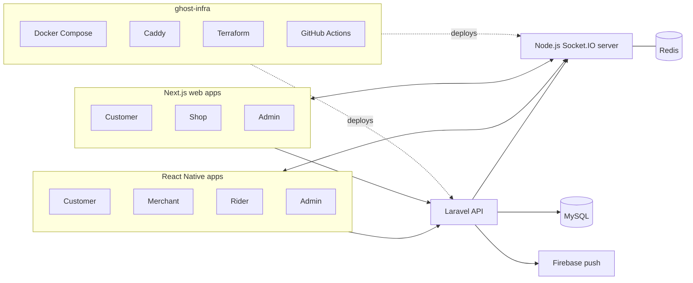
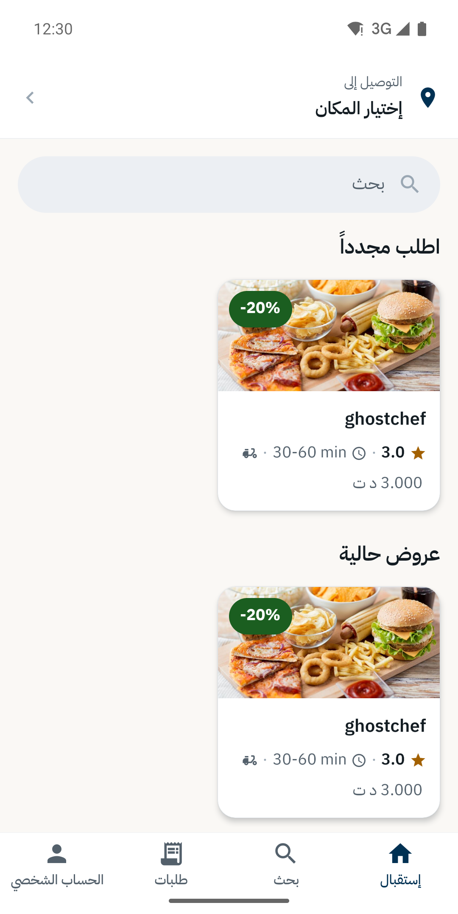
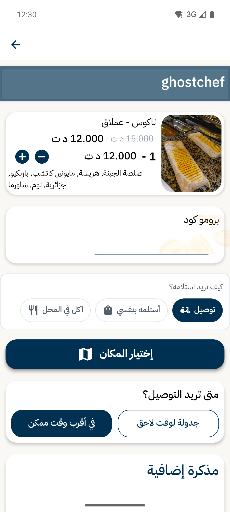
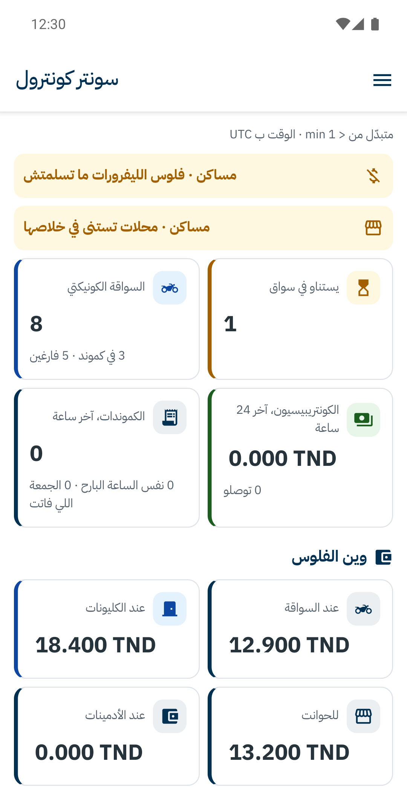
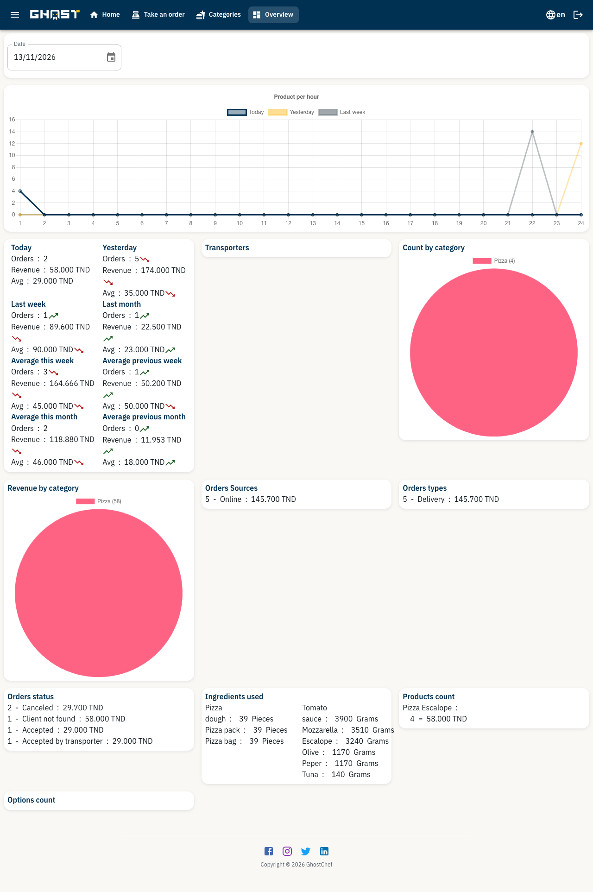
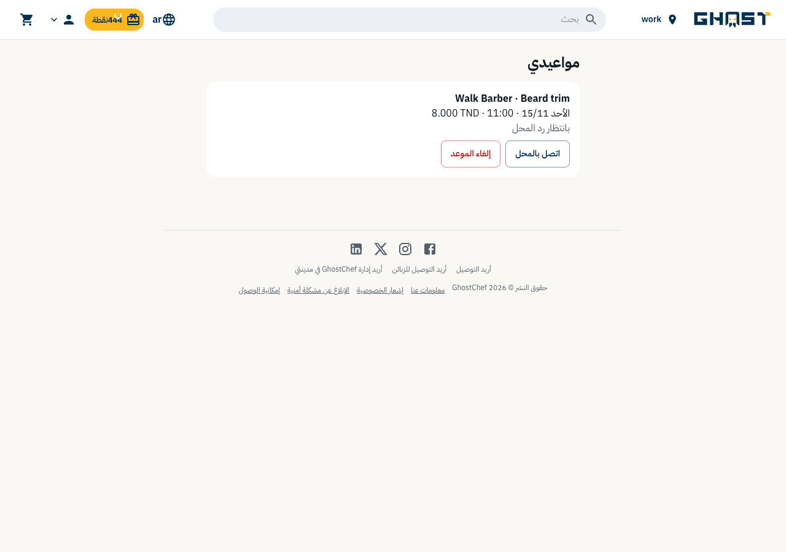

# GhostChef: one product, owned end to end since 2019

GhostChef is a food-ordering platform I started in 2019 and have owned ever since: product, architecture, code, infrastructure, and for almost two years the restaurant that ran on it. I wrote the first version by hand, and [that 2019 to 2023 code is public](https://github.com/stars/mkhinini-motaz/lists/ghostchef). A real restaurant took orders through it from December 2021 to October 2023, at 200+ orders a day at peak.

Since September 2026 I have been rebuilding it as a delivery platform with a coding agent (Claude Code) and my own agent tooling. It is in development and not launched. The new code is private; I walk through it on request.

*The 21 s demo (click the preview for the mp4).*

## Timeline

- **2019: by hand.** First commit to the API on 6 April 2019. I built the Laravel API and the customer web app.
- **Dec 2021 to Oct 2023: a restaurant runs on it.** I was co-founder and manager, and sole technical lead and architect. The platform ran its orders, store back office and mobile app.
- **May 2022: full-time.** Until April 2022 I ran the restaurant part-time, next to my job at Anypli.
- **2024 to 2025: pause.** There are no commits in these two years.
- **Sep 2026: rebuild with a coding agent.** Same product, new foundations, four React Native apps, an admin web app and an infrastructure repo.

| Year | Commits by hand | Agent-assisted commits |
|---|---|---|
| 2019 | 13 | 0 |
| 2020 | 151 | 0 |
| 2021 | 513 | 0 |
| 2022 | 251 | 0 |
| 2023 | 359 | 0 |
| 2024 to 2025 | 0 | 0 |
| 2026 (from 6 Sep) | about 200 without the trailer | 4,067 |

Totals: about 1,300 commits by hand, 4,271 since 6 September 2026. Counts cover ten repositories, five of them new in 2026 (the 2019 to 2023 rows come from the five older ones). A few early commits in the customer web app are by two other people; the rest are mine.

## What I own end to end

- **Product:** what gets built, in what order, and what is cut.
- **Architecture:** the split into apps, API and realtime service; the data model; the permission model.
- **Code:** API, web apps, mobile apps, realtime server.
- **Infrastructure:** containers, reverse proxy, Terraform, CI, backups, releases.
- **Operations (the restaurant years):** clients, suppliers, marketing and finances, next to the engineering.

## Architecture

Each box exists as a repository: `food-api`, `ghostws`, `food-client`, `food-shop`, `food-admin`, `ghostclient`, `ghostshopapp`, `ghostriderapp`, `ghostadminapp`, `ghost-infra`. The API serves four JWT surfaces (customer, shop, rider, admin). The realtime server uses the Socket.IO Redis adapter. Push goes through Firebase.

## Things worth a look

- **Five UI languages**, including Tunisian Derja in Arabic and in Latin script, with right-to-left layout (five locale files in the API and in the customer app).
- **Role-based access:** 11 admin roles and 5 shop roles. The API checks permissions in middleware and answers 403 when a role lacks one. There is no feature-flag system, only environment switches.
- **Tests:** 364 test files in the API and 366 across the four React Native apps (114 customer, 81 merchant, 62 rider, 109 admin). The three web apps have none yet.
- **Quality gates:** PHPStan with a baseline, GitHub Actions, and a secret-scan workflow in each repository.
- **Simulators and emulator walks** in `ghost-infra`: scripted days of orders, riders and merchants, and 25 written walks through the apps on an emulator.

| | | |
|---|---|---|
|  |  |  |
| Customer app, Arabic | Cart, Arabic | Admin app, Derja, RTL |
|  |  |  |
| Rider app | Shop web overview | Customer web, Arabic |

All data in the screenshots is test data.

## How I work with a coding agent

Since September 2026 most commits are written with Claude Code and carry a co-author trailer. I do not hide that: `git log` shows it.

What I do: product decisions, architecture, the rules files the agent reads, and review of what it produces. The agent types much of the code; I decide what the code is for and whether it is right.

My own tooling around it:

- custom subagents (a `worker` agent and ten business-advisor agents);
- hooks: a git guard, docs-size limits, and state restore after context compaction;
- command-line tools, written by Claude Code: a token-usage report from session transcripts, cost per subagent, a docs-size checker, a dev-server reaper;
- an eval suite for the advisor agents: each gets a question set, a judge model checks every answer against a checklist, with a no-advisor baseline and repeated trials.

## Videos

- [21 s demo](media/brag.mp4)
- Order film, 84 s: [English](media/ghostchef-order-film-en.mp4), [French](media/ghostchef-order-film-fr.mp4), [Arabic](media/ghostchef-order-film-ar.mp4)
- Cartoon film, 106 s: [English](media/ghostchef-cartoon-en.mp4), [French](media/ghostchef-cartoon-fr.mp4), [Arabic](media/ghostchef-cartoon-ar.mp4)

The films show the planned launch in M'saken; the platform is not live yet.

## Status

In development, not launched. The code is private; a walkthrough is available on request.

Links: [LinkedIn](https://www.linkedin.com/in/moatez-mkhinini) and [GitHub](https://github.com/mkhinini-motaz).

## How these numbers were measured

All on 17 November 2026, in the private repositories.

- Commits per year: `git log --format=%ad --date=format:%Y` per repository, summed. Agent-assisted: `git log --since=2026-09-06 --format=%B | grep -c '^Co-Authored-By: Claude'`, summed over the ten repositories (4,067 of 4,271).
- Test files: `git ls-files` counts per repository, the same day. A stricter filename pattern gives 360 for the API and 368 for the apps, so both are about right.
- Roles: the role constants in the API's admin and shop-user models. Locales: the five `*.json` files in the API's `resources/lang` and the customer app's `src/i18n`.
- Walks: `ls ghost-infra/emu/walks/*.md | wc -l` (25). Video lengths: `ffprobe`.
- Orders per day (200+ at peak) and the restaurant dates are my own records, not a command.
