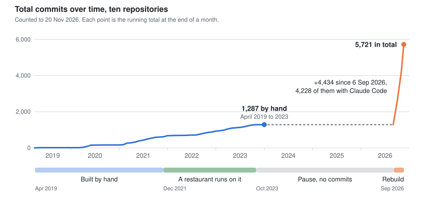
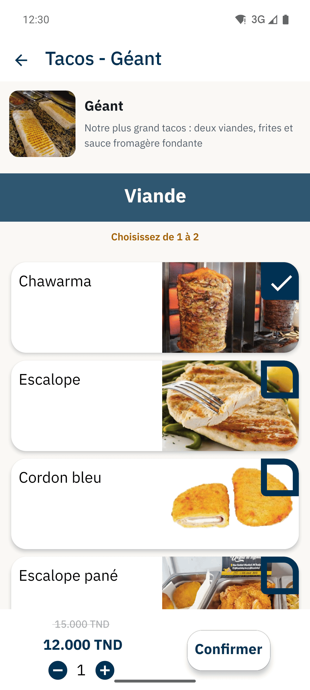
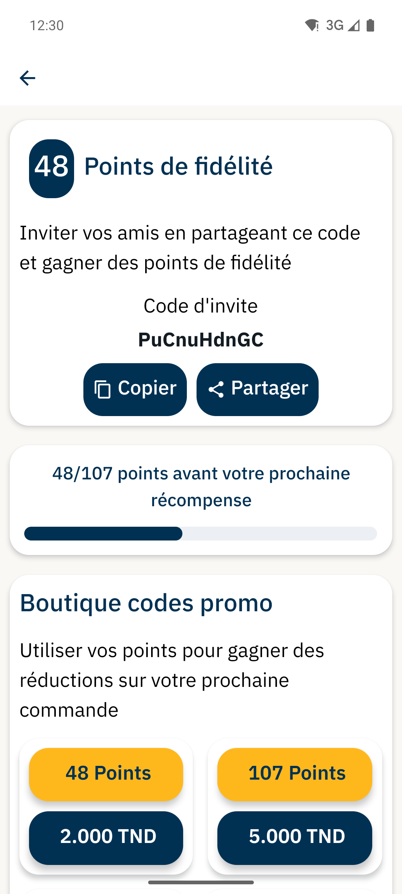
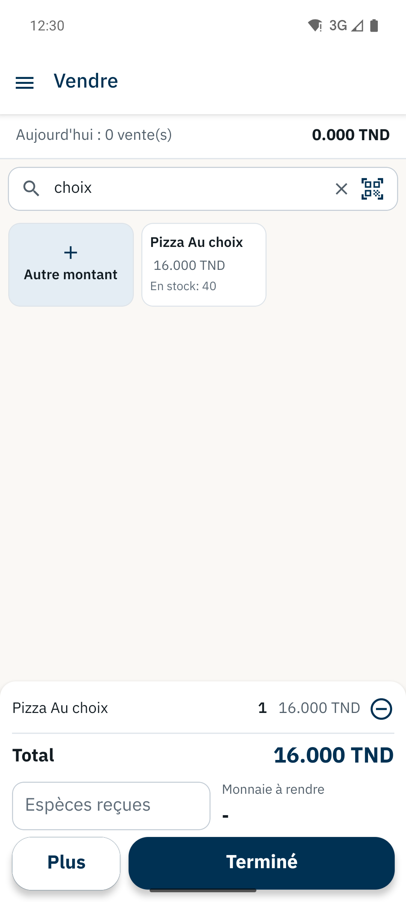
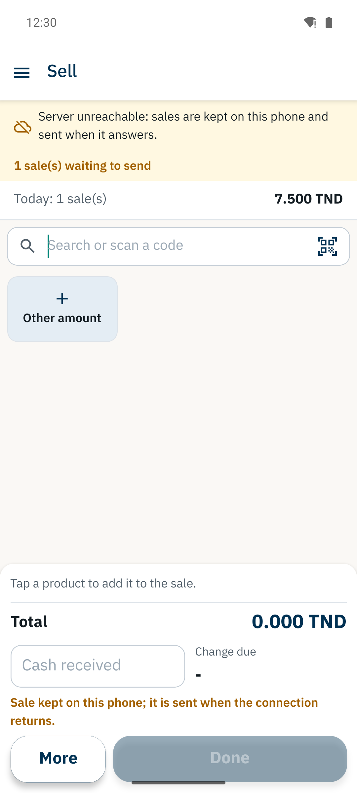
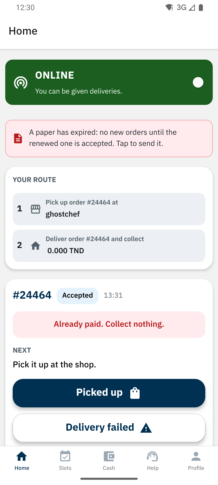
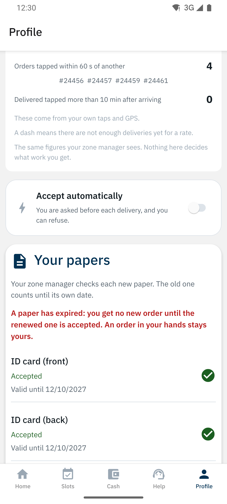
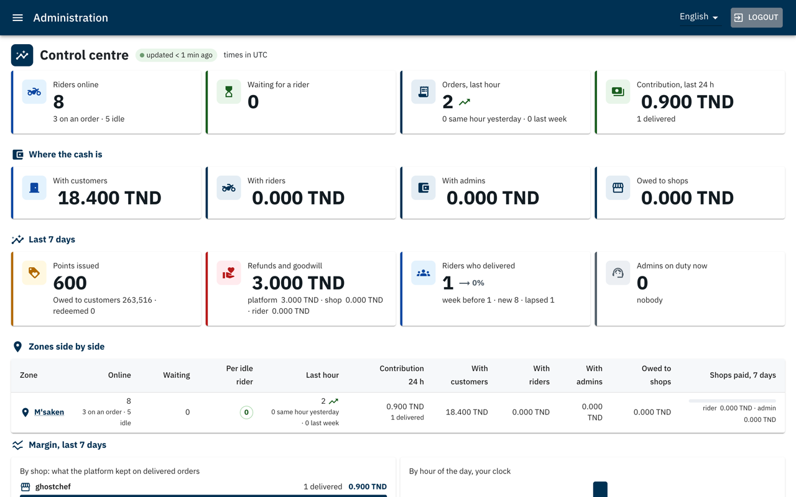
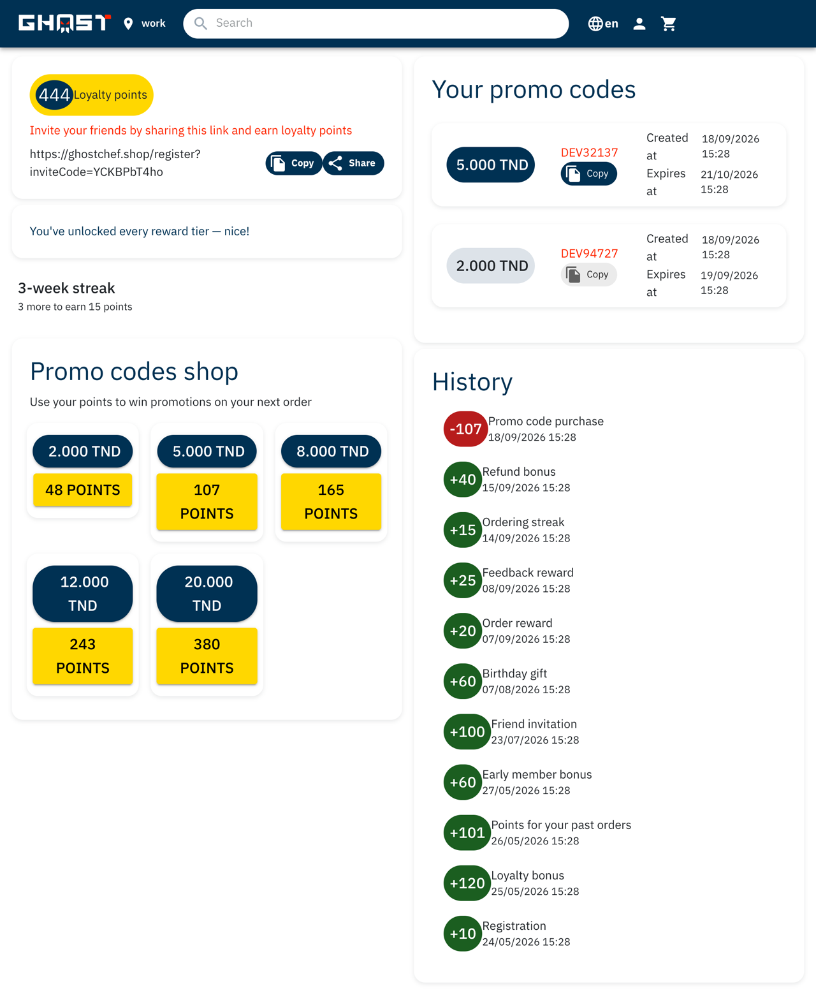

# GhostChef: one product, owned end to end since 2019

GhostChef is a food-ordering platform I started in 2019 and have owned ever since: product, architecture, code, infrastructure, and for almost two years the restaurant that ran on it. I wrote the first version by hand, and [that 2019 to 2023 code is public](https://github.com/stars/mkhinini-motaz/lists/ghostchef). A real restaurant took orders through it from December 2021 to October 2023, at 200+ orders a day at peak.

The restaurant's pages are still online: [Facebook](https://www.facebook.com/ghostchef.tn) with 5.3K followers, [Instagram](https://www.instagram.com/ghostchef.tn/), and [Google Maps](https://maps.google.com/?cid=8810174624179311072) with 4.5 stars from 12 reviews, now marked as permanently closed.

Since September 2026 I have been rebuilding it as a delivery platform for restaurants, shops and service businesses, with a coding agent (Claude Code) and my own agent tooling. It is in development and not launched. I build it in my own time; if it launches, a local partner runs operations and I stay the owner and engineer. The new code is private; I walk through it on request.

*The 21 s demo (click the preview for the mp4).*

## Timeline

- **2019: by hand.** First commit to the API on 6 April 2019. I built the Laravel API and the customer web app.
- **Dec 2021 to Oct 2023: a restaurant runs on it.** I was co-founder and manager, and sole technical lead and architect. The platform ran its orders, store back office and mobile app.
- **May 2022: full-time.** Until April 2022 I ran the restaurant part-time, next to my job at Anypli.
- **2024 to 2025: pause.** There are no commits in these two years.
- **Sep 2026: rebuild with a coding agent.** Same product, new foundations, four React Native apps, an admin web app and an infrastructure repo.

Commits per year as a table

| Year | Commits by hand | Agent-assisted commits |
|---|---|---|
| 2019 | 13 | 0 |
| 2020 | 151 | 0 |
| 2021 | 513 | 0 |
| 2022 | 251 | 0 |
| 2023 | 359 | 0 |
| 2024 to 2025 | 0 | 0 |
| 2026 (6 Sep to 20 Nov) | about 200 without the trailer | 4,228 |

Totals: about 1,300 commits by hand, 4,434 since 6 September 2026. Counts cover ten repositories, five of them new in 2026 (the 2019 to 2023 rows come from the five older ones). A few early commits in the customer web app are by two other people; the rest are mine.

## What I own end to end

- **Product:** what gets built, in what order, and what is cut.
- **Architecture:** the split into apps, API and realtime service; the data model; the permission model.
- **Code:** API, web apps, mobile apps, realtime server.
- **Infrastructure:** containers, reverse proxy, Terraform, CI, backups, releases.
- **Operations (the restaurant years):** clients, suppliers, marketing and finances, next to the engineering.

## What the platform does

Four sides use it: customers, shops, riders and the operations team. Each has a phone app, and all but riders have a web app too.

**Customers**
- Delivery, collection at the shop or eating in, ordered now or scheduled for a later time.
- Dish options with defaults and a price quote before checkout.
- Group cart: friends join with a code and add their own items, and one person pays for the whole order.
- Live order tracking, with the rider shown on a map.
- Loyalty points for orders, reviews, referrals, birthdays and ordering streaks, spent on promo codes with a monthly cap.
- One rating per order with reasons and photos, plus cancellation, refunds, disputes and a help inbox.
- Appointments at service shops such as barbers, car washes and tailors, and jewelry pieces reserved online and collected at the shop.

**Shops**
- 18 shop categories and 8 service categories, from restaurants and butchers to jewelers and barbers.
- Incoming orders ring on the shop's phone; staff accept, prepare and hand them to a rider, and a ready screen shows which orders wait for collection.
- A free POS for counter and phone sales. It keeps working offline and sends the sales when the server answers again.
- Menu editor with options, hidden items and reordering. Menu changes wait for an admin's review; price changes show at once.
- Weighed items for butchers and fishmongers: the shop records the real weight, with tolerance rules and a call to the customer when an item comes up short.
- Stock tracking with ingredients, recipes, purchases, waste and blind counts. It never blocks an order.
- Promotions the shop pays for, with a report for each one, and replies to customer reviews.
- Staff accounts with five roles, sales summaries and a monthly summary.

**Riders**
- Sign-up with document upload. An admin reviews each paper, and an expired paper stops new orders until a renewed one is accepted.
- Delivery offers go to one rider at a time, nearest first, with a time limit to accept and an optional auto-accept.
- Availability slots, a cash ledger of the money the rider holds, an SOS button and a performance view.

**Operations team**
- Dispatch board: automatic dispatch with a pause per zone, manual assignment and held orders when no rider is online.
- Zones drawn on a map, each with its own fees, riders and staff. A zone manager sees only their own zones.
- Cash tracking from customer to rider to shop to platform, with counted handovers, payout runs and a lost-cash process.
- Expenses, profit and loss, and fee statements per zone.
- Customer, shop and rider management: onboarding, document review, suspension, merging duplicate customers and point adjustments that need approval.
- A support inbox for all three sides, disputes, refunds and moderation of ratings and photos.
- Marketing banners and campaigns with a weekly cap per customer, and an editor for the loyalty rules.
- Scorecards for shops, riders and customers, alerts routed by type, a risk queue and an audit log of every change.

**Across the platform**
- Every order is paid in cash, by design. Amounts are stored in millimes and the prices in force are stamped on each order.
- Privacy consent per version of the notice, account deletion, and accessibility checks against RGAA 4.1.2, the French accessibility standard.
- A local guide called City (places, notices, a marketplace, lost and found), built in parts and not finished.

## Architecture

<picture><source media="(prefers-color-scheme: dark)" srcset="docs/diagrams/architecture-dark.svg"></picture>

Each box exists as a repository: `food-api`, `ghostws`, `food-client`, `food-shop`, `food-admin`, `ghostclient`, `ghostshopapp`, `ghostriderapp`, `ghostadminapp`, `ghost-infra`. They are private. The code I wrote by hand from 2019 to 2023 is public: [Food](https://github.com/mkhinini-motaz/Food) (the API), [food-ws](https://github.com/mkhinini-motaz/food-ws) (realtime), [food-client](https://github.com/mkhinini-motaz/food-client), [food-shop](https://github.com/mkhinini-motaz/food-shop), [deliveryapp](https://github.com/mkhinini-motaz/deliveryapp) and [ghostclient](https://github.com/mkhinini-motaz/ghostclient). The API serves four JWT surfaces (customer, shop, rider, admin). The realtime server uses the Socket.IO Redis adapter. Push goes through Firebase.

## Simulation testing

Before a feature lands, a simulated town plays a whole evening against the real platform. Bots act as customers, shop staff, riders and admins, and make the same HTTP and Socket.IO calls as the apps.

They run against the real API, queue worker, scheduler and realtime server, in a copy with its own database, Redis and ports. Text messages and push notifications go to a file, and the tools refuse any database whose name does not mark it as a simulation copy.

A checker watches every run and writes a report: what broke, response times per endpoint, and a night report per zone. A real finding becomes a failing API test first, then the fix. Every feature's spec names its simulator change, or says why it needs none.

- **The town:** 6 zones drawn from real town boundaries, 50 shops with real-style menus and opening hours, 72 riders and 890 customers.
- **Scripts:** 45 order scripts, 105 world events and 16 abuse cases. Examples: a double-tapped checkout, a rider who ignores an offer, a promo code used twice, nobody at the door.
- **Modes:** a smoke run of every script, busy evenings, a played week, a 45-minute load test at 300 orders an hour, and chaos runs that restart Redis, the realtime server, the queue and the API.
- **Checks during the run:** order states only move forward, a shop never sees a customer's phone number, each zone charges its own fee, a closed zone takes no order.
- **Checks after the run:** nothing is stuck, every app shows the same status and total, cash and points balances add up, and every refusal message exists in all five languages.
- **Bugs it found:** a double-tapped checkout placed two orders, a rider's offer showed the customer's phone number, and a race between two jewelry reservations returned a server error. Each now has a test.
- **Scale:** one smoke run on 21 November 2026 played 70 orders and sent 64,357 API requests in 39 minutes.
- **Emulator walks:** 25 written walks drive the four phone apps on an Android emulator, from order to delivery, with Arabic and large-text passes.

I turned the method into a public Claude Code skill: [simulate](https://github.com/mkhinini-motaz/simulate). It reads a project's routes and roles, writes the rules with their sources, generates the bots, keeps the same database guard, and counts a finding only when a failing test proves it.

## Things worth a look

- **Five UI languages**, including Tunisian Derja in Arabic and in Latin script, with right-to-left layout (five locale files in the API and in the customer app).
- **Role-based access:** 15 admin roles, 63 named permissions and 5 shop roles. The API checks permissions in middleware and answers 403 when a role lacks one.
- **Admin switches:** the operations team turns features on and off from the admin apps, with no deploy, and each change records who made it:
  - automatic dispatch, per zone;
  - ordering in one zone or everywhere, now or on a schedule;
  - each loyalty rule, and the City sections per zone;
  - over 100 limits, such as how long a rider has to accept an offer.
- **Tests:** 364 test files in the API and 366 across the four React Native apps (114 customer, 81 merchant, 62 rider, 109 admin). The three web apps have none yet.
- **Quality gates:** PHPStan with a baseline, GitHub Actions, and a secret-scan workflow in each repository.

## Screens

Phone apps:

| Customer app, Arabic home | Customer app, Arabic cart | Customer app, dish options |
|:---:|:---:|:---:|
|  |  |  |
| **Customer app, loyalty points** | **Shop app, POS** | **Shop app, offline sale** |
|  |  |  |
| **Rider app, route** | **Rider app, papers** | **Admin app, Derja** |
|  |  |  |

Web apps:

| Admin web, control centre | Shop web, sales overview |
|:---:|:---:|
|  |  |
| **Customer web, Arabic menu** | **Customer web, loyalty and promo codes** |
|  |  |

All data in the screenshots is test data.

## How I work with a coding agent

Since September 2026 most commits are written with Claude Code and carry a co-author trailer. I do not hide that: `git log` shows it.

What I do: product decisions, architecture, the rules files the agent reads, and review of what it produces. The agent types much of the code; I decide what the code is for and whether it is right.

Where I overrode the agent:

- **Inventory never blocks an order.** The agent's first inventory build let a shop's stock count refuse orders. I had it removed: a count typed in wrong must not turn customers away. A test pins it.
- **No platform fee on POS orders.** The agent read a zero fee on a shop's own POS orders as a bug and charged it. I reverted that: the platform never bills a shop's POS sales.
- **Admin invites by SMS.** A task spec said to send admin password invites by email. I chose SMS, because most people who use apps like these in Tunisia do not use email.
- **grep over a code graph.** I A/B-tested a code-graph tool for my agents against plain grep: the same tokens, 28% slower, and blind to parts of Laravel. I dropped it as the default.

My own tooling around it:

- custom subagents: a `worker` agent ([public](https://github.com/mkhinini-motaz/claude-code-session-toolkit/tree/main/worker-agent)) and ten business-advisor agents ([public as founder-advisors](https://github.com/mkhinini-motaz/founder-advisors));
- hooks: a git guard, docs-size limits, and state restore after context compaction;
- command-line tools, written by Claude Code: a token-usage report from session transcripts, cost per subagent, a docs-size checker, a dev-server reaper (public in [claude-code-session-toolkit](https://github.com/mkhinini-motaz/claude-code-session-toolkit));
- an eval suite for the advisor agents: each gets a question set, a judge model checks every answer against a checklist, with a no-advisor baseline and repeated trials.

## Videos

- [21 s demo](media/brag.mp4)
- Order film, 84 s: [English](media/ghostchef-order-film-en.mp4), [French](media/ghostchef-order-film-fr.mp4), [Arabic](media/ghostchef-order-film-ar.mp4)
- Cartoon film, 106 s: [English](media/ghostchef-cartoon-en.mp4), [French](media/ghostchef-cartoon-fr.mp4), [Arabic](media/ghostchef-cartoon-ar.mp4)

The films show the planned launch in M'saken, which a local partner would run; the platform is not live yet.

## Status

In development, not launched. The code is private; a walkthrough is available on request.

Links: [LinkedIn](https://www.linkedin.com/in/moatez-mkhinini) and [GitHub](https://github.com/mkhinini-motaz).

## How these numbers were measured

Test files on 17 November 2026, everything else on 21 November 2026, in the private repositories. Commits are counted up to 20 November 2026.

- Commits per year: `git log --format=%ad --date=format:%Y` per repository, summed. Agent-assisted: `git log --since=2026-09-06 --format=%B | grep -c '^Co-Authored-By: Claude'`, summed over the ten repositories (4,228 of 4,434). The chart is the running total per month of the same `git log`.
- Test files: `git ls-files` counts per repository, the same day. A stricter filename pattern gives 360 for the API and 368 for the apps, so both are about right.
- Roles and permissions: `Admin::ROLES` (15), the permission names in the API's `Permission` class (63) and the shop-user roles (5). Shop kinds: `Shop::CATEGORIES` (18) and `SERVICE_CATEGORIES` (8). Admin limits: 124 entries in the platform settings catalogue.
- Locales: the five `*.json` files in the API's `resources/lang` and the customer app's `src/i18n`.
- Simulator: scripts counted by loading `scenarios.mjs` and `fraud.mjs` in Node; the town from the zone table in the simulator's README; the smoke run from its `summary.md`. Walks: `ls ghost-infra/emu/walks/*.md | wc -l` (25).
- Restaurant pages: follower counts and the Google rating as the pages showed them on 21 November 2026.
- Video lengths: `ffprobe`. Orders per day (200+ at peak) and the restaurant dates are my own records, not a command.
